# PedalRaya - Platform Komunitas & Rute Bersepeda (Fullstack)
> **Tugas Praktikum Pemrograman Web - Bab 9: NestJS Dasar + Struktur MVC**

---

## Identitas Mahasiswa

- **Nama Lengkap:** Rizqi Nawaf Putra Rosyadi
- **NIM:** 103122430010
- **Kelas:** SE08-02
- **Mata Kuliah:** Pemrograman Web (PPWEB)
- **Topik Aplikasi:** Platform Komunitas Pesepeda, Eksplorasi Rute Gowes, dan Lapak Jual Beli Perlengkapan Sepeda

---

## Deskripsi Singkat Proyek

**PedalRaya** adalah aplikasi fullstack berbasis web yang dirancang khusus untuk ekosistem komunitas pesepeda di Indonesia. Aplikasi ini memungkinkan para pegiat gowes untuk:
1. **Menjelajahi & Berbagi Rute Bersepeda:** Melihat informasi jarak, elevasi, perkiraan waktu tempuh, kondisi jalur, hingga rekomendasi rasio gigi/ban.
2. **Koleksi & Manajemen Rute (Fitur Utama):** Menambahkan rute petualangan baru, memperbarui kondisi jalan, dan mengelola koleksi rute favorit.
3. **Lapak Komunitas:** Jual beli sepeda utuh, spare part, dan aksesoris gowes terpercaya.
4. **Titik Temu & Pitstop:** Informasi kafe, bengkel, dan rest area ramah pesepeda.

Pada **Bab 9**, fondasi backend dibangun menggunakan **NestJS** dengan menerapkan pola arsitektur **MVC (Model-View-Controller)**, Dependency Injection, validasi data otomatis menggunakan `class-validator`, dan terintegrasi secara *real-time* dengan frontend **React (Vite + Tailwind CSS)**.

---

## Struktur Proyek (Monorepo Folder)

```text
Pedalraya/
├── backend/                  # Backend Application (NestJS MVC + TypeScript)
│   ├── src/
│   │   ├── routes/
│   │   │   ├── dto/
│   │   │   │   ├── create-route.dto.ts   # DTO Validasi POST (class-validator)
│   │   │   │   └── update-route.dto.ts   # DTO Validasi PATCH (PartialType)
│   │   │   ├── entities/
│   │   │   │   └── route.entity.ts       # Model Entity Rute (>5 variasi tipe data)
│   │   │   ├── routes.controller.ts      # Controller REST API (GET, POST, PATCH, DELETE)
│   │   │   ├── routes.service.ts         # Service CRUD In-Memory Array + Exceptions
│   │   │   └── routes.module.ts          # Module Konfigurasi Routes
│   │   ├── app.module.ts
│   │   └── main.ts                       # Entrypoint: Global ValidationPipe & CORS
│   ├── routes.http                       # File Uji Coba REST Client (VS Code)
│   ├── test-api.js                       # Skrip Otomasi Pengujian Seluruh Endpoint
│   └── package.json
│
├── frontend/                 # Frontend Application (React 19 + Vite + Tailwind CSS 4)
│   ├── src/
│   │   ├── components/
│   │   │   ├── Header.jsx                # Navigasi + Status Indikator API Backend
│   │   │   ├── RouteCard.jsx             # Kartu Rute (Aksi: Detail, Edit, Hapus)
│   │   │   ├── RouteForm.jsx             # Controlled Form (Tambah POST & Ubah PATCH)
│   │   │   ├── RouteList.jsx             # Filter, Pencarian, & Conditional Rendering
│   │   │   ├── RouteDetailModal.jsx      # Modal Detail Rute Lengkap
│   │   │   └── RouteStats.jsx            # Ringkasan Statistik Rute
│   │   ├── services/
│   │   │   └── api.js                    # API Client Fetch ke Backend NestJS
│   │   ├── App.jsx                       # State Management & Handler Terintegrasi API
│   │   └── main.jsx
│   └── package.json
│
├── docs/
│   └── screenshots/          # Dokumentasi Tangkapan Layar Pengujian API & UI
│       ├── 01-rest-client-get-all.png
│       ├── 02-rest-client-get-one.png
│       ├── 03-rest-client-post-create.png
│       ├── 04-rest-client-patch-update.png
│       ├── 05-rest-client-delete.png
│       ├── 06-rest-client-error-notfound-404.png
│       ├── 07-rest-client-error-conflict-409.png
│       ├── 08-rest-client-error-validation-400.png
│       ├── 09-frontend-route-list.png
│       ├── 10-frontend-add-route-modal.png
│       ├── 11-frontend-edit-route-modal.png
│       └── 12-frontend-delete-flow.png
│
├── .gitignore
└── README.md
```

---

## Panduan Instalasi & Menjalankan Aplikasi

Pastikan di komputer Anda telah terinstal **Node.js** (minimal v18/v20) dan **npm**.

### 1. Jalankan Backend (NestJS)

Buka terminal pertama, lalu jalankan perintah berikut:

```bash
# 1. Masuk ke direktori backend
cd backend

# 2. Install seluruh dependensi
npm install

# 3. Jalankan server dalam mode development
npm run start:dev
```

Server backend NestJS akan aktif di:
- **Base URL:** `http://localhost:3000`
- **Routes API:** `http://localhost:3000/routes`

---

### 2. Jalankan Frontend (React + Vite)

Buka terminal kedua, lalu jalankan perintah berikut:

```bash
# 1. Masuk ke direktori frontend
cd frontend

# 2. Install seluruh dependensi
npm install

# 3. Jalankan server development Vite
npm run dev
```

Aplikasi frontend akan aktif di:
- **URL Frontend:** `http://localhost:5173`
- Buka tautan tersebut di peramban browser Anda.

---

## Pembahasan Rinci 8 Butir Pengerjaan Tugas Bab 9

### 1. Data Utama Aplikasi
- **Data Utama:** **Rute Bersepeda (`Route`)**
- Data ini merepresentasikan lintasan gowes yang dieksplorasi oleh komunitas, lengkap dengan spesifikasi fisik jalur, elevasi tanjakan, tingkat kesulitan, serta rekomendasi keamanan.

---

### 2. Nest CLI Resource & Struktur Entity
Resource digenerate menggunakan perintah resmi Nest CLI:
```bash
nest g resource routes --type rest --crud true
```
Struktur data disesuaikan pada file `backend/src/routes/entities/route.entity.ts` dengan minimal 5 field dengan tipe data bervariasi:
- `id`: `string` (Identifier unik, contoh: `"route-1"`)
- `nama`: `string` (Nama rute)
- `kategori`: `'road' | 'gravel' | 'mtb' | 'touring' | 'leisure'` (String Union / Enum)
- `kategoriLabel`: `string` (Label disiplin bersepeda)
- `lokasi`: `string` (Kota / daerah administrasi)
- `jarak`: `number` (Jarak rute dalam kilometer)
- `elevasi`: `number` (Total tanjakan dalam meter/mdpl)
- `durasi`: `string` (Perkiraan waktu tempuh, contoh: `"2.5 Jam"`)
- `kesulitan`: `'mudah' | 'menengah' | 'sulit'` (String Union / Enum)
- `kesulitanLabel`: `string` (Label tingkat tantangan)
- `terverifikasi`: `boolean` (Status kurasi komunitas)
- `createdAt`: `Date` (Waktu rute ditambahkan)

---

### 3. Service CRUD dengan Penyimpanan In-Memory
Diimplementasikan pada `backend/src/routes/routes.service.ts`:
- **Penyimpanan:** Data disimpan dalam variabel privat memori `private routes: Route[] = [...]` berisi data inisial realistis rute nusantara.
- **Operasi CRUD:**
  - `create(createRouteDto)`: Menyimpan rute baru ke awal array memori.
  - `findAll(query)`: Mengembalikan seluruh daftar rute (mendukung filter kategori, kesulitan, dan pencarian nama).
  - `findOne(id)`: Mengambil satu rute berdasarkan ID.
  - `update(id, updateRouteDto)`: Memperbarui field rute secara selektif.
  - `remove(id)`: Menghapus data rute dari memori array melalui `splice`.

---

### 4. Controller & Dependency Injection
Diimplementasikan pada `backend/src/routes/routes.controller.ts`:
- **Dependency Injection:** Controller meminta instance service melalui konstruktor:
  ```typescript
  constructor(private readonly routesService: RoutesService) {}
  ```
- **HTTP Methods:**
  - `@Post()` → `create(@Body() createRouteDto: CreateRouteDto)`
  - `@Get()` → `findAll(@Query() query)`
  - `@Get(':id')` → `findOne(@Param('id') id: string)`
  - `@Patch(':id')` → `update(@Param('id') id: string, @Body() updateRouteDto: UpdateRouteDto)`
  - `@Delete(':id')` → `remove(@Param('id') id: string)`

---

### 5. DTO & ValidationPipe Global
Dibuat pada `backend/src/routes/dto/create-route.dto.ts` dan `update-route.dto.ts`:
- Menggunakan aturan validasi dari `class-validator`:
  1. `@IsString()` & `@IsNotEmpty()`: Memastikan data teks terisi.
  2. `@MinLength(3)` & `@MaxLength(100)`: Membatasi panjang karakter nama rute.
  3. `@IsIn(['road', 'gravel', 'mtb', 'touring', 'leisure'])`: Validasi opsi kategori.
  4. `@IsNumber()` & `@Min(0.1)`: Validasi nilai angka jarak minimal 0.1 km.
  5. `@IsNumber()` & `@Min(0)`: Validasi elevasi tidak boleh bernilai negatif.
  6. `@IsIn(['mudah', 'menengah', 'sulit'])`: Validasi tingkat kesulitan.
  7. `@IsBoolean()`: Validasi tipe data status verifikasi rute.
  8. `@IsOptional()`: Field pendukung bersifat opsional.
- `UpdateRouteDto` mengekstensi `PartialType(CreateRouteDto)` dari `@nestjs/mapped-types`.
- **ValidationPipe Diaktifkan Global** pada `backend/src/main.ts`:
  ```typescript
  app.useGlobalPipes(
    new ValidationPipe({
      whitelist: true,
      forbidNonWhitelisted: true,
      transform: true,
      transformOptions: { enableImplicitConversion: true },
    }),
  );
  ```

---

### 6. Exception Handling Bawaan NestJS
Menggunakan exception bawaan NestJS yang relevan:
1. **`NotFoundException` (HTTP 404):**
   - Dilempar saat `findOne(id)`, `update(id)`, atau `remove(id)` jika ID rute yang dicari tidak ditemukan di array memori.
   - Pesan error: `"Rute dengan ID ... tidak ditemukan pada sistem PedalRaya."`
2. **`ConflictException` (HTTP 409):**
   - Dilempar saat `create()` atau `update()` jika nama rute yang dimasukkan sudah ada di dalam koleksi (mencegah rute duplikat).
   - Pesan error: `"Rute dengan nama ... sudah terdaftar di PedalRaya."`
3. **`BadRequestException` (HTTP 400):**
   - Dilempar secara otomatis oleh `ValidationPipe` ketika data payload request melanggar aturan DTO.

---

### 7. Pengujian Endpoint via REST Client (File & Screenshot)
Telah disediakan file `backend/routes.http` untuk pengujian langsung menggunakan ekstensi REST Client di VS Code. Seluruh skenario telah diuji dan menghasilkan response sesuai standar HTTP:

| No | Endpoint | Method | Status Code | Keterangan |
|---|---|---|---|---|
| 1 | `/routes` | `GET` | `200 OK` | Mengambil seluruh rute di memori |
| 2 | `/routes/route-1` | `GET` | `200 OK` | Mengambil satu rute spesifik |
| 3 | `/routes` | `POST` | `201 Created` | Menambahkan rute baru ke memori |
| 4 | `/routes/route-1` | `PATCH` | `200 OK` | Memperbarui atribut rute |
| 5 | `/routes/route-5` | `DELETE` | `200 OK` | Menghapus rute dari memori |
| 6 | `/routes/route-999` | `GET` | `404 Not Found` | Skenario `NotFoundException` |
| 7 | `/routes` (duplikat) | `POST` | `409 Conflict` | Skenario `ConflictException` |
| 8 | `/routes` (invalid) | `POST` | `400 Bad Request` | Skenario validasi `ValidationPipe` |

---

### 8. Sambungan Backend dengan Frontend (Alur Lengkap)
Frontend React (`frontend`) telah disambungkan ke backend NestJS melalui client service `frontend/src/services/api.js`:
- **Read (GET):** Saat pertama kali dibuka, frontend memuat rute dari endpoint `http://localhost:3000/routes`.
- **Create (POST):** Melalui tombol "+ Tambah Rute ke Koleksi", pengguna mengisi formulir controlled component dan mengirimkan request POST ke backend.
- **Update (PATCH):** Pada setiap kartu rute terdapat tombol "✎ Edit" yang membuka modal modifikasi data rute dan mengirim request PATCH ke backend.
- **Delete (DELETE):** Tombol "Hapus" pada kartu rute akan meminta konfirmasi lalu mengeksekusi request DELETE ke backend.
- **Indikator Koneksi:** Di bagian Header aplikasi terdapat pill indikator `🟢 NestJS API Terhubung (:3000)` yang memantau kesiapan backend.

---

## Lampiran Tangkapan Layar (Screenshots)

Berikut adalah dokumentasi hasil uji coba REST Client dan antarmuka aplikasi terintegrasi:

### A. Uji Coba REST Client (Backend NestJS)

#### 1. HTTP GET /routes (Ambil Semua Rute)
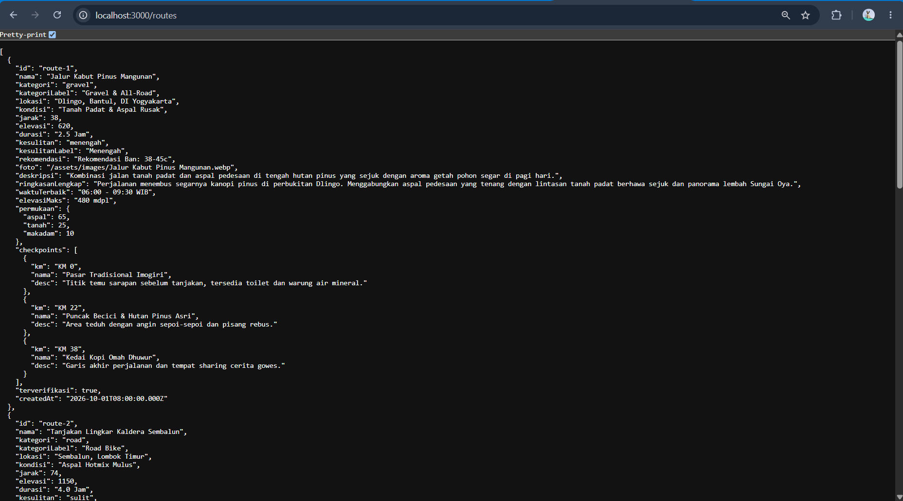

---

#### 2. HTTP GET /routes/:id (Ambil Rute Berdasarkan ID)
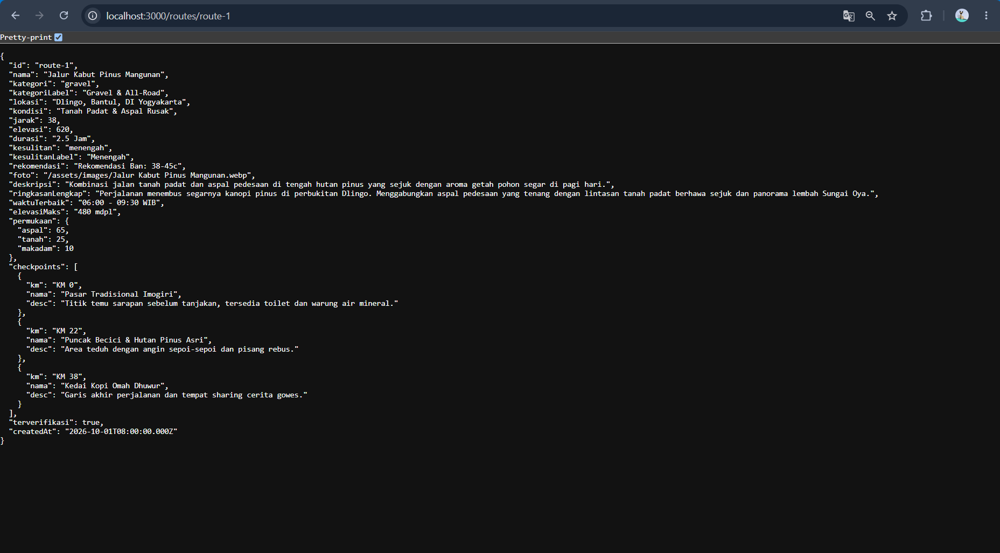

---

#### 3. HTTP POST /routes (Tambah Rute Baru - 201 Created)
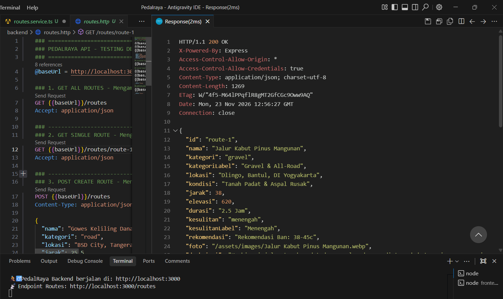

---

#### 4. HTTP PATCH /routes/:id (Perbarui Rute - 200 OK)
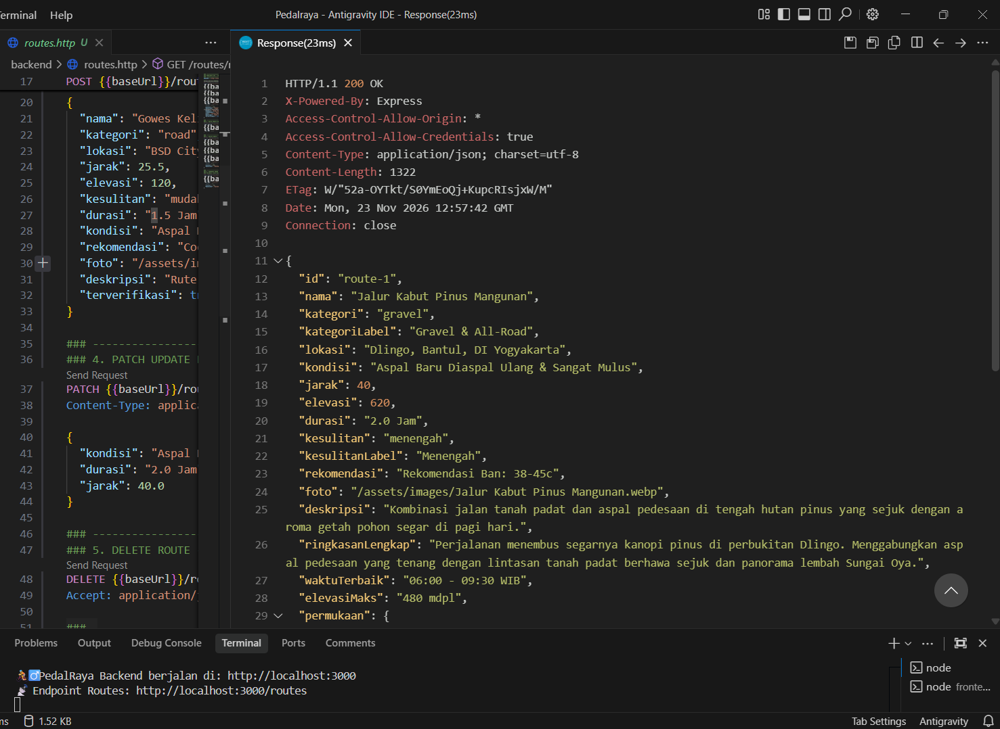

---

#### 5. HTTP DELETE /routes/:id (Hapus Rute - 200 OK)
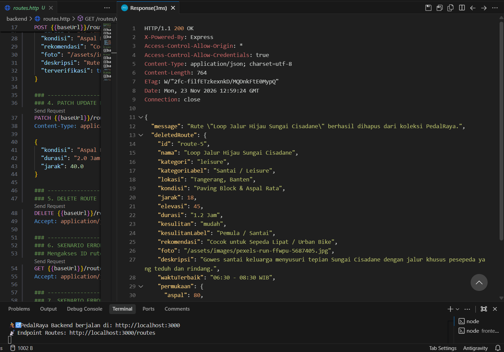

---

#### 6. Skenario Error 1: NotFoundException (404 Not Found)
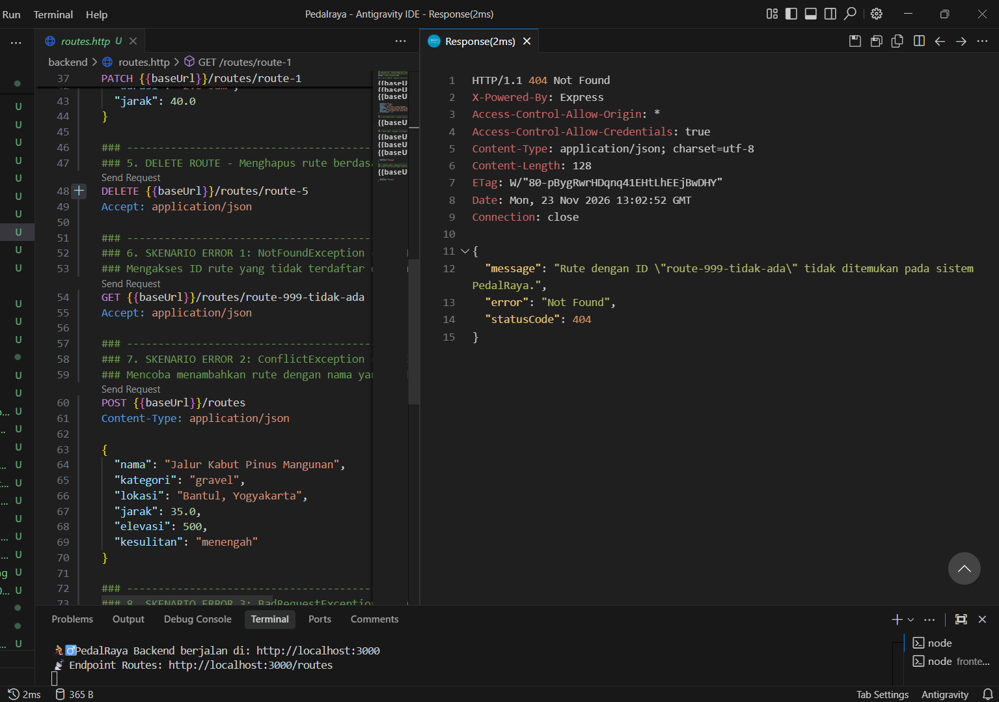

---

#### 7. Skenario Error 2: ConflictException (409 Conflict - Duplikat Nama)
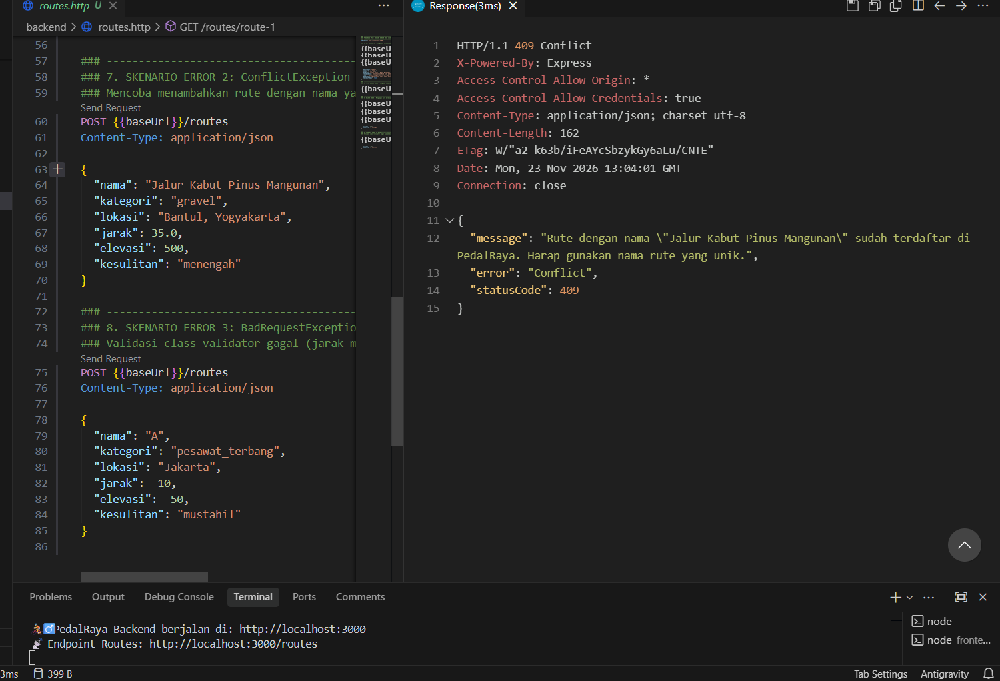

---

#### 8. Skenario Error 3: BadRequestException via ValidationPipe (400 Bad Request)
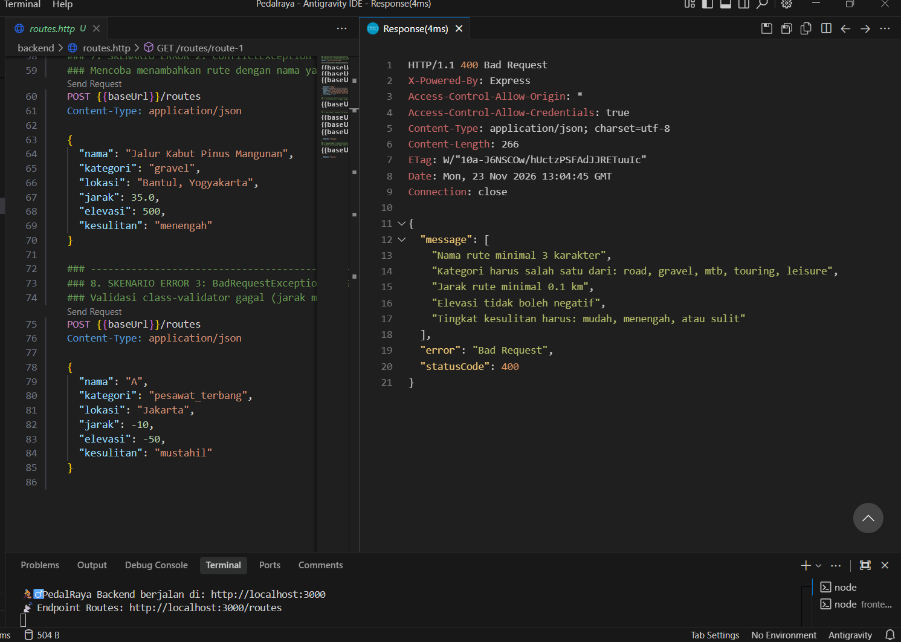

---

### B. Antarmuka Frontend Terintegrasi (React + NestJS)

#### 9. Halaman Eksplorasi Rute Terhubung ke Backend NestJS
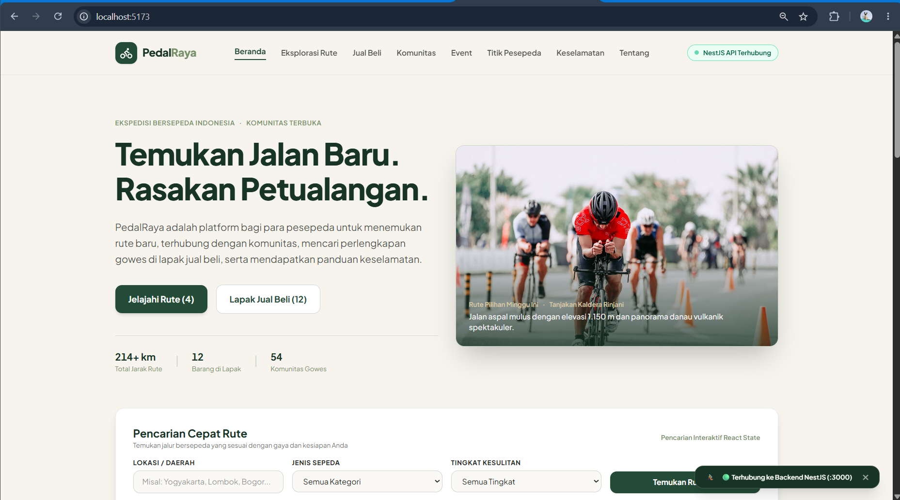

---

#### 10. Form Modal Tambah Rute Baru (Alur POST)
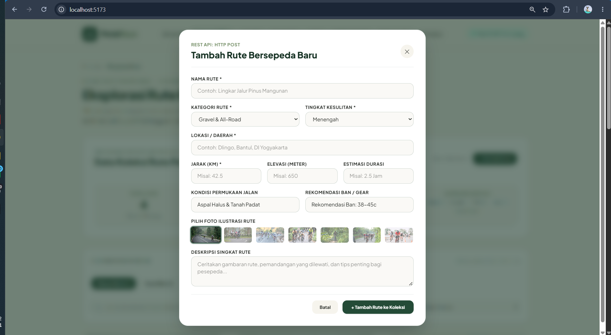

---

#### 11. Form Modal Ubah / Edit Rute (Alur PATCH)
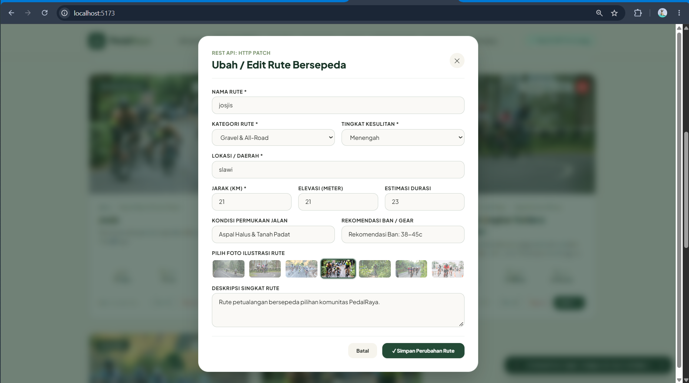

---

#### 12. Hapus Rute & Notifikasi Toast (Alur DELETE)
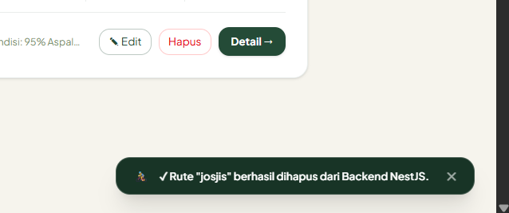

---

## Informasi Pengumpulan
- **Link Repository GitHub:** https://github.com/gogowap/Pemrograman-WEB-Pedal-raya-_Rizqi-Nawaf-Putra-Rosyadi_1031224300110_SE08-02.git
- **Pengumpulan:** LMS Telkom University / Sesuai Instruksi Dosen Pengampu Bab 9.
